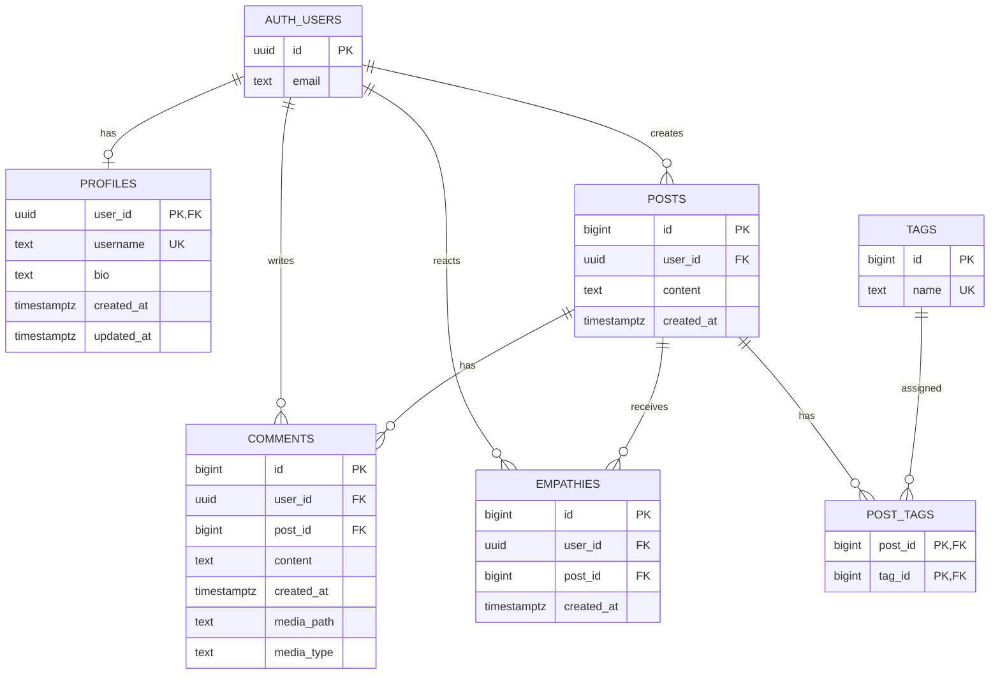

# DATABASE.md

# Echo - データベース設計書

## 1. 概要

### 1.1 目的

本ドキュメントは、匿名SNS「Echo」で使用するデータベースの構造、テーブル間のリレーション、アクセス制御、データ操作方針を定義する。

Claude Codeなどの開発支援ツールは、データベースに関係する実装・修正・リファクタリングを行う際、本ドキュメントを参照すること。

### 1.2 データベース構成

- DBMS：PostgreSQL
- BaaS：Supabase
- 認証：Supabase Auth
- アクセス制御：Row Level Security（RLS）

Supabaseが提供するPostgreSQLデータベースを利用する。

### 1.2.1 実DB調査の反映状況

本ドキュメントは、2026-11-23時点のSupabase実DB調査結果（`public`スキーマのテーブル構造とRLSポリシー）を反映している。

- 調査対象：アプリケーション用の`public`スキーマ（全6テーブル、RLSはすべて有効）
- 調査対象外：`auth`・`storage`などSupabase管理スキーマ、レコードの内容
- 調査で確認できなかった項目（インデックス、トリガー、関数、ポリシー名、`empathies`のUNIQUE制約、ON DELETE CASCADEの実設定など）は「未確認」として残している。

チャットでの画像・動画投稿機能（`docs/plans/features/chat-media-upload.md`）のSQLを実DBに適用済み。以下は上記の調査とは別に、実行したSQLの内容を反映したもの。

- `comments`への列（`media_path` / `media_type`）とCHECK制約の追加、`comments_content_check`の置き換え
- Storageバケット`chat-media`の作成と`storage.objects`のポリシー追加
- 適用後の実DBの状態（制約・ポリシー名など）は再調査していない。

### 1.3 基本方針

- ユーザー情報はSupabase Authで管理する。
- アプリケーション固有のプロフィール情報はprofilesで管理する。
- 投稿・コメント・共感などはそれぞれ独立したテーブルで管理する。
- 投稿とタグの関係は中間テーブルで管理する。
- 各テーブルでRLSを有効にする。
- ユーザー本人以外が本人限定データを操作できないようにする。
- 関連データの整合性は外部キー制約で確保する。

---

# 2. テーブル一覧

現在使用している主なテーブルは以下の6つ。

| テーブル名 | 役割 |
|---|---|
| posts | 投稿情報 |
| profiles | ユーザープロフィール |
| comments | コメント |
| empathies | 投稿への共感 |
| tags | タグ情報 |
| post_tags | 投稿とタグの中間テーブル |

認証情報はSupabase Authの`auth.users`で管理する。

テーブルとは別に、チャットの画像・動画はSupabase Storageのバケット`chat-media`で管理する（「3.8 Storage（chat-media）」参照）。

---

# 3. テーブル定義

## 3.1 auth.users

Supabase Authが管理するユーザー情報。

アプリケーション側で独自に認証情報を保存しない。

主な利用カラム：

| カラム | 型 | 説明 |
|---|---|---|
| id | uuid | ユーザーID（主キー） |
| email | text | メールアドレス |

※Supabase Authが管理するテーブルであり、実際のカラム構成はSupabaseの仕様に従う。

### 利用方法

- ユーザー登録時にSupabase Authがユーザーを作成する。
- ログイン時に認証情報を検証する。
- `id`を各テーブルの`user_id`と関連付ける。
- `auth.uid()`によって現在ログインしているユーザーを判定する。

---

## 3.2 posts（投稿）

ユーザーが作成した投稿を管理する。

### テーブル定義

```sql
create table posts (
  id bigint generated always as identity primary key,
  user_id uuid not null references auth.users(id) on delete cascade,
  content text not null,
  created_at timestamptz default now()
);
```

### カラム一覧

| カラム | 型 | 制約 | 説明 |
|---|---|---|---|
| id | bigint | PK | 投稿ID |
| user_id | uuid | FK / NOT NULL | 投稿者のユーザーID |
| content | text | NOT NULL / CHECK | 投稿本文（500文字以下・空白のみ不可 / `posts_content_check`） |
| created_at | timestamptz | DEFAULT now() | 投稿日時 |

```sql
alter table posts
  add constraint posts_content_check
  check (
    char_length(content) <= 500
    and btrim(content, E' \t\n\r　') <> ''
  );
```

※上記の CHECK 制約は本番DBに適用済み（実DB調査で確認）。

### リレーション

- auth.users.id → posts.user_id
- 1ユーザーが複数の投稿を作成できる。
- 1投稿は1人のユーザーに属する。

### データ操作

| 操作 | 権限 |
|---|---|
| SELECT | 認証済みユーザー |
| INSERT | 自分のユーザーIDを指定した場合のみ |
| UPDATE | 自分の投稿のみ |
| DELETE | 自分の投稿のみ |

### 注意事項

- 投稿内容は空文字・空白のみを登録しない。
- フロントエンドで入力値を検証する。
- データベース側のRLSでも操作権限を制御する。
- 投稿削除時は外部キー制約による関連データの削除を考慮する。

---

## 3.3 profiles（プロフィール）

ユーザーのプロフィール情報を管理する。

### テーブル定義

```sql
create table profiles (
  user_id uuid primary key references auth.users(id) on delete cascade,
  username text unique,
  bio text,
  created_at timestamptz default now(),
  updated_at timestamptz default now()
);
```

### カラム一覧

| カラム | 型 | 制約 | 説明 |
|---|---|---|---|
| user_id | uuid | PK / FK | ユーザーID |
| username | text | UNIQUE | ユーザー名 |
| bio | text | - | 自己紹介 |
| created_at | timestamptz | DEFAULT now() | 作成日時 |
| updated_at | timestamptz | DEFAULT now() | 更新日時 |

### リレーション

- auth.users.id → profiles.user_id
- 1ユーザーにつき1プロフィール。
- user_idを主キーとして使用する。

### データ操作

| 操作 | 権限 |
|---|---|
| SELECT | 認証済みユーザー |
| INSERT | 自分のプロフィールのみ |
| UPDATE | 自分のプロフィールのみ |
| DELETE | 不可（DELETEポリシーなし） |

### プロフィールの仕様

- usernameはユーザー間で重複できない。
- usernameは最大30文字（アプリ側の検証のみ。DB側のCHECK制約は確認されていない）。
- bioは最大200文字（アプリ側の検証のみ。DB側のCHECK制約は確認されていない）。
- usernameは必須入力。
- プロフィール更新にはupsertを使用している。
- usernameが重複した場合、PostgreSQLの一意制約違反（23505）を処理する。

### 注意事項

`updated_at`を自動更新するトリガーの有無は要確認。

---

## 3.4 comments（コメント）

投稿に対するコメントを管理する。

### テーブル定義

```sql
create table comments (
  id bigint generated always as identity primary key,
  user_id uuid not null references auth.users(id) on delete cascade,
  post_id bigint not null references posts(id) on delete cascade,
  content text not null,
  created_at timestamptz not null default now(),
  media_path text,
  media_type text
);

-- 本文：500文字以下。空白のみは不可（ただしメディア付きなら空文字を許可）
alter table comments
  add constraint comments_content_check
  check (
    char_length(content) <= 500
    and (
      btrim(content, E' \t\n\r　') <> ''
      or (content = '' and media_path is not null)
    )
  );

-- メディア種別は image / video のみ
alter table comments
  add constraint comments_media_type_check
  check (media_type in ('image', 'video'));

-- media_path と media_type は両方あるか、両方ないか
alter table comments
  add constraint comments_media_pair_check
  check ((media_path is null) = (media_type is null));

-- 自分のユーザーID・同じ投稿IDのフォルダ以外のファイルを参照させない
alter table comments
  add constraint comments_media_path_owner_check
  check (
    media_path is null
    or media_path like user_id::text || '/' || post_id::text || '/%'
  );
```

※`media_path` / `media_type`と3つのメディア関連CHECK制約、および`comments_content_check`の置き換え（旧制約をDROPして再作成）は、チャット画像・動画投稿機能のSQLとして実行済み。上記の制約名はそのSQLで指定した名前。

### カラム一覧

| カラム | 型 | 制約 | 説明 |
|---|---|---|---|
| id | bigint | PK | コメントID |
| user_id | uuid | FK / NOT NULL | コメント投稿者 |
| post_id | bigint | FK / NOT NULL | コメント対象の投稿 |
| content | text | NOT NULL / CHECK | コメント本文（500文字以下。空白のみ不可。メディア付きの場合のみ空文字`''`可） |
| created_at | timestamptz | NOT NULL / DEFAULT now() | 投稿日時 |
| media_path | text | NULL可 / CHECK | 添付メディアのStorage上のパス（`{user_id}/{post_id}/{uuid}.{ext}`） |
| media_type | text | NULL可 / CHECK | 添付メディアの種別（`image` / `video`） |

### メディア添付の仕様

- 1コメント（メッセージ）につき添付できるメディアは最大1件。複数送る場合は複数のコメントとして送信する。
- メディアのみのコメントは`content = ''`、`media_path`・`media_type`を設定して登録する。
- `media_path`と`media_type`は両方設定するか、両方NULLにする（`comments_media_pair_check`）。
- `media_path`は`{user_id}/{post_id}/`で始まる必要があり、自分以外のフォルダや別の投稿のフォルダを参照できない（`comments_media_path_owner_check`）。
- 実ファイルは非公開バケット`chat-media`に保存する（「3.8 Storage（chat-media）」参照）。
- 投稿画面（`posts`）では画像・動画を添付できない。
- 既存のコメントは`media_path` / `media_type`がNULLのまま。

### リレーション

- auth.users.id → comments.user_id
- posts.id → comments.post_id
- 1ユーザーは複数のコメントを作成できる。
- 1投稿は複数のコメントを持つ。

### データ操作

| 操作 | 権限 |
|---|---|
| SELECT | 認証済みユーザー |
| INSERT | 自分のユーザーIDを指定した場合のみ |
| UPDATE | 不可（UPDATEポリシーなし） |
| DELETE | 自分のコメントのみ |

### 注意事項

- コメントは対象となる投稿に紐付ける。
- 投稿削除時は関連コメントも削除される。
- コメント投稿者のusernameはprofilesから取得する。
- コメントを削除しても、Storage上のファイルは自動では削除されない。アプリ側で`media_path`のファイルも削除する。
- 投稿削除（ON DELETE CASCADE）やアカウント削除でコメントが消えた場合、Storage上のファイルは残る（孤立ファイル）。現時点では対応していない既知の制約。
- コメントのUPDATEポリシーがないため、送信後にメディアを差し替えることはできない。

---

## 3.5 empathies（共感）

ユーザーが投稿に対して行った共感を管理する。

### テーブル定義

```sql
create table empathies (
  id bigint generated always as identity primary key,
  user_id uuid not null references auth.users(id) on delete cascade,
  post_id bigint not null references posts(id) on delete cascade,
  created_at timestamptz not null default now(),
  unique(user_id, post_id)
);
```

### カラム一覧

| カラム | 型 | 制約 | 説明 |
|---|---|---|---|
| id | bigint | PK | 共感ID |
| user_id | uuid | FK / NOT NULL | 共感したユーザー |
| post_id | bigint | FK / NOT NULL | 共感対象の投稿 |
| created_at | timestamptz | NOT NULL / DEFAULT now() | 共感日時 |

### リレーション

- auth.users.id → empathies.user_id
- posts.id → empathies.post_id
- 1ユーザーは複数の投稿に共感できる。
- 1投稿は複数のユーザーから共感される。

### 一意制約

```sql
unique(user_id, post_id)
```

同じユーザーが同じ投稿に複数回共感することを防止する。

※この一意制約は実DB調査結果に記載がなく、実DBでの存在は未確認。存在しない場合は同一ユーザーの重複共感が可能になるため、Supabase上で確認すること。

### データ操作

| 操作 | 権限 |
|---|---|
| SELECT | 認証済みユーザー |
| INSERT | 自分のユーザーIDを指定した場合のみ |
| UPDATE | 不可（UPDATEポリシーなし） |
| DELETE | 自分の共感のみ |

### 共感の仕様

- 共感ボタンを押すと共感を登録する。
- すでに共感済みの場合は解除する。
- 共感数は対象投稿のempathies件数で管理する。
- 共感数を別カラムで保持する設計にはしていない。

---

## 3.6 tags（タグ）

投稿に設定できるタグのマスターデータを管理する。

### テーブル定義

```sql
create table tags (
  id bigint generated always as identity primary key,
  name text not null unique
);
```

### カラム一覧

| カラム | 型 | 制約 | 説明 |
|---|---|---|---|
| id | bigint | PK | タグID |
| name | text | NOT NULL / UNIQUE | タグ名 |

### 初期データ

```sql
insert into tags (name)
values
  ('恋愛'),
  ('人間関係'),
  ('仕事'),
  ('学校'),
  ('家族'),
  ('日常'),
  ('将来'),
  ('その他')
on conflict (name) do nothing;
```

### データ操作

| 操作 | 権限 |
|---|---|
| SELECT | 認証済みユーザー |
| INSERT | 不可（書き込みポリシーなし） |
| UPDATE | 不可（書き込みポリシーなし） |
| DELETE | 不可（書き込みポリシーなし） |

### 注意事項

- クライアント（authenticated）からはタグの作成・編集・削除ができない。タグの追加・変更はSQLエディタ等で行う。
- ユーザーがタグを作成・編集する機能が必要になった場合は、権限設計（ポリシー追加）を別途検討する。
- タグはマスターデータとして扱う。
- 投稿に設定するタグはtagsに存在するものから選択する。
- タグ名は重複できない。
- 現在の投稿作成画面では複数タグを選択できる。

---

## 3.7 post_tags（投稿とタグの中間テーブル）

投稿とタグの多対多の関係を管理する。

### テーブル定義

```sql
create table post_tags (
  post_id bigint not null references posts(id) on delete cascade,
  tag_id bigint not null references tags(id) on delete cascade,
  primary key (post_id, tag_id)
);
```

### カラム一覧

| カラム | 型 | 制約 | 説明 |
|---|---|---|---|
| post_id | bigint | PK / FK / NOT NULL | 投稿ID |
| tag_id | bigint | PK / FK / NOT NULL | タグID |

### リレーション

- posts.id → post_tags.post_id
- tags.id → post_tags.tag_id
- 1投稿に複数のタグを設定できる。
- 1タグを複数の投稿に設定できる。

### 主キー

```sql
primary key (post_id, tag_id)
```

同じ投稿に同じタグを複数回登録することを防止する。

### データ操作

| 操作 | 権限 |
|---|---|
| SELECT | 認証済みユーザー |
| INSERT | 自分の投稿に対してのみ |
| UPDATE | 不可（UPDATEポリシーなし。付け替えはDELETE→INSERT） |
| DELETE | 自分の投稿に対してのみ |

### 注意事項

- 投稿削除時は関連するpost_tagsも削除される。
- タグ削除時も関連するpost_tagsが削除される。
- 投稿とタグの関連付けはpost_tagsで管理する。

---

## 3.8 Storage（chat-media）

チャットに投稿された画像・動画を保存するSupabase Storageのバケット。`public`スキーマのテーブルではなく、`storage`スキーマ（`storage.buckets` / `storage.objects`）で管理される。

### バケット定義

```sql
insert into storage.buckets (id, name, public, file_size_limit, allowed_mime_types)
values (
  'chat-media',
  'chat-media',
  false,
  52428800, -- 50MB（動画の上限。画像の10MBはアプリ側で検証）
  array[
    'image/jpeg', 'image/png', 'image/webp', 'image/gif',
    'video/mp4', 'video/webm', 'video/quicktime'
  ]
);
```

| 項目 | 値 | 説明 |
|---|---|---|
| id / name | chat-media | バケット名 |
| public | false | 非公開。表示には署名付きURLが必要 |
| file_size_limit | 52428800（50MB） | 1ファイルの上限。画像の上限10MBはアプリ側で検証する |
| allowed_mime_types | JPEG / PNG / WebP / GIF / MP4 / WebM / QuickTime | クライアント検証を回避されてもサーバー側で拒否する |

### ファイルパス

```text
chat-media/{user_id}/{post_id}/{uuid}.{拡張子}
```

- 1階層目を`user_id`にし、RLSで本人のフォルダにのみ書き込めるようにする。
- この`{user_id}/{post_id}/{uuid}.{拡張子}`が`comments.media_path`に保存される（バケット名は含まない）。
- ファイル名は`crypto.randomUUID()`で生成し、拡張子は元のファイル名ではなくMIMEから決める。

### データ操作

| 操作 | 権限 |
|---|---|
| SELECT | 認証済みユーザー（署名付きURLの発行に必要） |
| INSERT | 自分の`user_id`フォルダにのみ |
| UPDATE | 不可（UPDATEポリシーなし。上書き・差し替え不可） |
| DELETE | 自分の`user_id`フォルダのファイルのみ |

### 注意事項

- 画像・動画は認証済みユーザーのみ閲覧できる。URLは期限付きの署名付きURLで発行する（有効期限は1時間を想定）。
- 実ファイルを持つコメントを削除したときは、アプリ側でStorageのファイルも削除する（DBのON DELETE CASCADEはStorageのファイルに及ばない）。
- 投稿やアカウントの削除で消えたコメントのファイルはStorageに残る（既知の制約）。
- JPEG / PNG / WebPはアップロード前にブラウザ側のCanvasで再エンコードし、EXIFなどのメタデータを除去する。GIF・動画のメタデータは除去されない。
- Service Role Keyは使用しない。アップロード・署名URL発行・削除はすべてauthenticatedロールのRLS経由で行う。

---

# 4. テーブル間のリレーション

## 4.1 ER図



※AUTH_USERSはSupabase Authが管理するテーブル。上記はアプリケーションで利用する関係を簡略化したもの。

## 4.2 リレーション一覧

| 親テーブル | 子テーブル | 関係 | 外部キー |
|---|---|---|---|
| auth.users | profiles | 1対1 | profiles.user_id |
| auth.users | posts | 1対多 | posts.user_id |
| auth.users | comments | 1対多 | comments.user_id |
| auth.users | empathies | 1対多 | empathies.user_id |
| posts | comments | 1対多 | comments.post_id |
| posts | empathies | 1対多 | empathies.post_id |
| posts | post_tags | 1対多 | post_tags.post_id |
| tags | post_tags | 1対多 | post_tags.tag_id |

postsとtagsはpost_tagsを介した多対多の関係。

`comments.media_path`はStorageバケット`chat-media`内のファイルパスを指す。外部キーではなく文字列で参照するため、DB側ではファイルの存在や削除は連動しない（「3.8 Storage（chat-media）」参照）。

---

# 5. Row Level Security（RLS）

## 5.1 基本方針

全テーブルでRLSを有効にし、ユーザーごとにデータ操作の権限を制御する。

実DB調査により、`public`スキーマの全6テーブルでRLSが有効であることを確認済み。ポリシーはすべてPERMISSIVE、対象ロールは`authenticated`。

フロントエンド側の表示制御だけではセキュリティを確保できないため、データベース側でも必ず権限を確認する。

## 5.2 RLSの基本構造

```text
User
 |
 v
Supabase Auth
 |
 | 認証済みユーザーのJWT
 v
PostgreSQL
 |
 v
RLS Policy
 |
 | auth.uid()でユーザーIDを取得
 v
操作対象のuser_idと比較
 |
 +---- 一致 ----> 操作許可
 |
 +---- 不一致 --> 操作拒否
```

## 5.3 RLSの有効化

以下のテーブルでRLSを有効にしている（実DBで確認済み）。

```sql
alter table posts enable row level security;
alter table profiles enable row level security;
alter table comments enable row level security;
alter table empathies enable row level security;
alter table tags enable row level security;
alter table post_tags enable row level security;
```

Storageの`storage.objects`はSupabaseがRLSを有効にして管理している（`chat-media`用のポリシーは「5.4」「5.5」参照）。

## 5.4 各テーブルのポリシー方針

### posts

| 操作 | 条件 |
|---|---|
| SELECT | 認証済みユーザー |
| INSERT | auth.uid() = user_id |
| UPDATE | auth.uid() = user_id |
| DELETE | auth.uid() = user_id |

### profiles

| 操作 | 条件 |
|---|---|
| SELECT | 認証済みユーザー |
| INSERT | auth.uid() = user_id |
| UPDATE | auth.uid() = user_id（USING / WITH CHECK 両方） |
| DELETE | なし（ポリシーなし＝不可） |

### comments

| 操作 | 条件 |
|---|---|
| SELECT | 認証済みユーザー |
| INSERT | auth.uid() = user_id |
| UPDATE | なし（ポリシーなし＝不可） |
| DELETE | auth.uid() = user_id |

### empathies

| 操作 | 条件 |
|---|---|
| SELECT | 認証済みユーザー |
| INSERT | auth.uid() = user_id |
| UPDATE | なし（ポリシーなし＝不可） |
| DELETE | auth.uid() = user_id |

### tags

| 操作 | 条件 |
|---|---|
| SELECT | 認証済みユーザー |
| INSERT | なし（ポリシーなし＝不可） |
| UPDATE | なし（ポリシーなし＝不可） |
| DELETE | なし（ポリシーなし＝不可） |

### post_tags

| 操作 | 条件 |
|---|---|
| SELECT | 認証済みユーザー |
| INSERT | 関連するposts.user_idがauth.uid()と一致 |
| UPDATE | なし（ポリシーなし＝不可） |
| DELETE | 関連するposts.user_idがauth.uid()と一致 |

### posts（補足）

| 操作 | 条件 |
|---|---|
| UPDATE | USING / WITH CHECK 両方で auth.uid() = user_id（更新前・更新後とも本人） |

### storage.objects（chat-media）

`bucket_id = 'chat-media'`のオブジェクトに対するポリシー（対象ロールは`authenticated`）。

| 操作 | 条件 |
|---|---|
| SELECT | bucket_id = 'chat-media' |
| INSERT | bucket_id = 'chat-media' かつ パスの1階層目が auth.uid() と一致 |
| UPDATE | なし（ポリシーなし＝不可） |
| DELETE | bucket_id = 'chat-media' かつ パスの1階層目が auth.uid() と一致 |

※コメントの`media_path`と実ファイルの対応（`{user_id}/{post_id}/`）は`comments_media_path_owner_check`で保証する。Storage側のポリシーは1階層目（`user_id`）のみ確認する。

## 5.5 RLSポリシーの実装例

以下はポリシーの考え方を示す例。

ポリシーの条件（対象操作・USING / WITH CHECK）は実DB調査結果と一致するが、ポリシー名は未確認のため、実際の名前とは異なる可能性がある。

### posts

```sql
-- 認証済みユーザーは投稿を取得できる
create policy "Authenticated users can view posts"
on posts
for select
to authenticated
using (true);

-- 自分の投稿のみ登録できる
create policy "Users can insert own posts"
on posts
for insert
to authenticated
with check (auth.uid() = user_id);

-- 自分の投稿のみ更新できる
create policy "Users can update own posts"
on posts
for update
to authenticated
using (auth.uid() = user_id)
with check (auth.uid() = user_id);

-- 自分の投稿のみ削除できる
create policy "Users can delete own posts"
on posts
for delete
to authenticated
using (auth.uid() = user_id);
```

### profiles

```sql
create policy "Anyone authenticated can view profiles"
on profiles
for select
to authenticated
using (true);

create policy "Users can insert own profile"
on profiles
for insert
to authenticated
with check (auth.uid() = user_id);

create policy "Users can update own profile"
on profiles
for update
to authenticated
using (auth.uid() = user_id)
with check (auth.uid() = user_id);
```

### comments

```sql
create policy "Authenticated users can view comments"
on comments
for select
to authenticated
using (true);

create policy "Users can insert own comments"
on comments
for insert
to authenticated
with check (auth.uid() = user_id);

create policy "Users can delete own comments"
on comments
for delete
to authenticated
using (auth.uid() = user_id);
```

### empathies

```sql
create policy "Authenticated users can view empathies"
on empathies
for select
to authenticated
using (true);

create policy "Users can insert own empathies"
on empathies
for insert
to authenticated
with check (auth.uid() = user_id);

create policy "Users can delete own empathies"
on empathies
for delete
to authenticated
using (auth.uid() = user_id);
```

### tags

```sql
create policy "Authenticated users can view tags"
on tags
for select
to authenticated
using (true);
```

### post_tags

```sql
create policy "Authenticated users can view post tags"
on post_tags
for select
to authenticated
using (true);

create policy "Users can insert tags to own posts"
on post_tags
for insert
to authenticated
with check (
  exists (
    select 1
    from posts
    where posts.id = post_tags.post_id
      and posts.user_id = auth.uid()
  )
);

create policy "Users can delete tags from own posts"
on post_tags
for delete
to authenticated
using (
  exists (
    select 1
    from posts
    where posts.id = post_tags.post_id
      and posts.user_id = auth.uid()
  )
);
```

### storage.objects（chat-media）

```sql
-- ログインユーザーはチャットメディアを閲覧できる（署名付きURLの発行に必要）
create policy "Authenticated users can view chat media"
on storage.objects for select
to authenticated
using (bucket_id = 'chat-media');

-- 自分のフォルダにのみアップロードできる
create policy "Users can upload own chat media"
on storage.objects for insert
to authenticated
with check (
  bucket_id = 'chat-media'
  and (storage.foldername(name))[1] = auth.uid()::text
);

-- 自分のファイルのみ削除できる
create policy "Users can delete own chat media"
on storage.objects for delete
to authenticated
using (
  bucket_id = 'chat-media'
  and (storage.foldername(name))[1] = auth.uid()::text
);

-- UPDATEポリシーは作成しない（上書き・差し替え不可）
```

---

# 6. データ操作のルール

## 6.1 投稿の作成

1. ログインユーザーを取得する。
2. 投稿本文を入力する。
3. 入力内容を検証する。
4. postsに投稿を登録する。
5. 登録した投稿IDを取得する。
6. 選択したタグをpost_tagsに登録する。

投稿の登録とタグの登録は現在別々の処理である。

そのため、投稿登録成功後にタグ登録が失敗する可能性がある。

将来的にはRPCやトランザクションを利用した一括処理を検討する。

## 6.2 投稿の編集

1. 投稿者本人であることを確認する。
2. 投稿内容を入力する。
3. 空文字でないことを確認する。
4. postsをUPDATEする。
5. 更新成功後に画面を更新する。

DB側でもRLSによって本人以外の更新を防止する。

## 6.3 投稿の削除

1. 投稿者本人であることを確認する。
2. postsから対象投稿をDELETEする。
3. 外部キーのON DELETE CASCADEによって関連データを削除する。
4. 画面の投稿一覧を更新する。

関連データ：

- comments
- empathies
- post_tags

コメントに添付されたStorage上の画像・動画は、DBの外部キーでは削除されず残る（孤立ファイル。現時点では未対応）。

## 6.4 共感の追加・解除

1. 対象投稿の共感状態を確認する。
2. 未共感ならempathiesにINSERTする。
3. 共感済みならempathiesからDELETEする。
4. 共感数と状態を更新する。

一意制約によって重複登録を防止する。

## 6.5 コメントの作成

1. ログインユーザーを取得する。
2. 対象投稿IDを取得する。
3. コメント本文を検証する。
4. commentsにINSERTする。
5. コメント一覧を更新する。

### メディア付きコメントの作成

1. 画像・動画を選択し、形式とサイズを検証する（画像10MB・動画50MBまで）。
2. JPEG / PNG / WebPはCanvasで再エンコードしてメタデータを除去する（失敗した場合は元画像をアップロードせずエラーにする）。
3. `chat-media/{user_id}/{post_id}/{uuid}.{拡張子}`にアップロードする。
4. commentsにINSERTする（`content`は空なら`''`、`media_path`・`media_type`を設定）。
5. INSERTに失敗した場合は、アップロードしたファイルを削除する（孤立ファイル防止）。
6. 表示時は`media_path`から署名付きURLを発行する。

### メディア付きコメントの削除

1. commentsから対象コメントをDELETEする（本人のみ）。
2. `media_path`があれば、Storageからもファイルを削除する。Storage削除の失敗はログのみとし、画面上は削除済みとして扱う。

## 6.6 プロフィールの更新

1. ログインユーザーを取得する。
2. usernameとbioを入力する。
3. 入力値を検証する。
4. profilesにupsertする。
5. 更新結果を画面に反映する。

usernameの一意制約に違反した場合はエラーを表示する。

## 6.7 タグ検索

1. 選択されたタグIDを取得する。
2. post_tagsから該当するpost_idを取得する。
3. postsから該当投稿を取得する。
4. 投稿者情報とタグ情報を取得する。
5. 投稿一覧を更新する。

---

# 7. データ整合性・制約

## 7.1 主キー

各テーブルで主キーを設定する。

- posts.id
- profiles.user_id
- comments.id
- empathies.id
- tags.id
- post_tags (post_id, tag_id)

## 7.2 外部キー

ユーザー情報はauth.usersに紐付ける。

投稿関連データはpostsに紐付ける。

タグ関連データはtagsに紐付ける。

## 7.3 UNIQUE制約

以下の重複を防止する。

| テーブル | 対象 | 目的 |
|---|---|---|
| profiles | username | ユーザー名の重複防止 |
| empathies | user_id, post_id | 同じ投稿への重複共感防止 |
| tags | name | タグ名の重複防止 |
| post_tags | post_id, tag_id | 同じ投稿への同一タグの重複防止 |

## 7.3.1 CHECK制約

| テーブル | 制約名 | 内容 |
|---|---|---|
| posts | posts_content_check | 500文字以下・空白のみ不可 |
| comments | comments_content_check | 500文字以下・空白のみ不可（`media_path`があれば空文字を許可） |
| comments | comments_media_type_check | `media_type`は`image` / `video`のみ |
| comments | comments_media_pair_check | `media_path`と`media_type`は両方NULLか両方NOT NULL |
| comments | comments_media_path_owner_check | `media_path`は`{user_id}/{post_id}/`で始まる |

## 7.4 NOT NULL制約

以下の項目は必須。

- posts.user_id
- posts.content
- comments.user_id
- comments.post_id
- comments.content（メディアのみの場合は空文字`''`を設定し、NULLにはしない）
- empathies.user_id
- empathies.post_id
- tags.name
- post_tags.post_id
- post_tags.tag_id

## 7.5 ON DELETE CASCADE

現在確認できている外部キーでは、関連する親データが削除された際に子データも削除される。

特に以下に注意する。

- auth.users削除 → 関連するprofiles、posts、comments、empathiesを削除
- posts削除 → 関連するcomments、empathies、post_tagsを削除
- tags削除 → 関連するpost_tagsを削除

実際の外部キー設定はSupabase上で確認すること。

---

# 8. インデックス・パフォーマンス

現在、明示的に作成した追加インデックスの情報は未確認。

以下の検索・結合条件は今後のパフォーマンス改善時に確認する。

| テーブル | 対象カラム | 用途 |
|---|---|---|
| posts | created_at | 投稿日時順の一覧取得 |
| posts | user_id | ユーザー別投稿取得 |
| comments | post_id | 投稿別コメント取得 |
| empathies | post_id | 投稿別共感取得 |
| empathies | user_id | ユーザー別共感取得 |
| post_tags | tag_id | タグ別投稿検索 |
| post_tags | post_id | 投稿別タグ取得 |
| profiles | username | ユーザー名検索 |

主キーやUNIQUE制約によって作成されるインデックスと、追加で作成するインデックスは区別すること。

実際のデータ量やクエリ実行計画を確認せずに、無闇にインデックスを追加しない。

---

# 9. セキュリティ上の注意

## 9.1 RLSを必ず利用する

ユーザーがブラウザから直接Supabase APIを操作できることを前提とする。

フロントエンドでボタンを非表示にするだけでは、権限管理として不十分。

必ずRLSで制御する。

## 9.2 Service Role Key

SupabaseのService Role Keyは強い権限を持つため、クライアント側で使用しない。

NEXT_PUBLIC_が付く環境変数に秘密鍵を設定しない。

## 9.3 ユーザー入力

投稿・コメント・プロフィールなど、ユーザーが入力するデータは適切に検証する。

- 空文字の禁止
- 文字数制限
- 不正なデータ形式の確認
- HTMLやスクリプトの不適切な実行防止

## 9.4 RLSのテスト

以下のケースを確認する。

- 他人の投稿を更新できない。
- 他人の投稿を削除できない。
- 他人のプロフィールを更新できない。
- 他人のコメントを削除できない。
- 他人の共感を解除できない。
- 他人の投稿にタグを追加・削除できない。
- 未認証ユーザーが保護対象データを操作できない。
- 他人の`user_id`フォルダにチャットメディアをアップロードできない。
- 他人のチャットメディアを削除できない。
- 他人のフォルダや別の投稿のフォルダのパスを`media_path`に指定したコメントをINSERTできない。
- `media_type`に`image` / `video`以外を設定できない。
- `media_path`と`media_type`の片方だけを設定したコメントをINSERTできない。
- `media_path`がないのに`content`が空文字のコメントをINSERTできない。
- 許可外のMIMEタイプ、または50MBを超えるファイルを直接アップロードしても拒否される。
- 未認証ユーザーが署名付きURLの発行・チャットメディアのアップロードをできない。

## 9.5 実DB調査で判明した注意点

- `tags`には書き込みポリシーがなく、クライアントからタグの作成・編集・削除はできない。
- `comments`・`empathies`にはUPDATEポリシーがなく、RLS経由では更新できない。
- `profiles`にはDELETEポリシーがなく、RLS経由では削除できない。
- `post_tags`にはUPDATEポリシーがない。タグの変更はDELETE→INSERTで行う。
- `empathies`のUNIQUE(user_id, post_id)は調査結果に記載がなく、実DBでの存在は未確認。

## 9.6 チャットメディア（chat-media）に関する注意点

- バケット`chat-media`は非公開。画像・動画は署名付きURL（期限付き）で表示し、公開URLは使用しない。
- JPEG / PNG / WebPは、アップロード前にブラウザ側で再エンコードしてEXIF（位置情報・撮影日時・カメラ情報など）を除去する。サーバー側ではメタデータの除去を保証していない。GIF・動画のメタデータは除去されない。
- Storageにはクライアント側の検証とは別に、バケットの`allowed_mime_types`と`file_size_limit`（50MB）の制限がある。画像の10MB上限はアプリ側の検証のみ（DB・Storage側の制限はない）。
- コメントの削除、投稿やアカウントの削除に伴うStorageファイルの扱いは「3.4 comments」「3.8 Storage（chat-media）」を参照（孤立ファイルは未対応）。
- 適用後の実DBの制約名・ポリシー名・バケット設定は、実DB調査では再確認していない。

---

# 10. 今後の拡張候補

以下は将来の検討事項であり、現時点では実装済みではない。

## 10.1 通報機能

投稿やコメントの通報情報を管理するテーブルを追加する。

候補：

- reports

## 10.2 ブロック機能

ユーザー間のブロック関係を管理するテーブルを追加する。

候補：

- user_blocks

## 10.3 お気に入り・保存機能

投稿を保存する機能を追加する場合、専用テーブルを作成する。

候補：

- bookmarks

## 10.4 通知機能

共感やコメントなどの通知を管理するテーブルを追加する。

候補：

- notifications

## 10.5 投稿の非公開・公開範囲

公開範囲を設定する場合はpostsに公開状態を管理するカラムを追加することを検討する。

---

# 11. Claude Codeへのデータベース変更ルール

データベース関連の実装を行う場合は、以下を守ること。

## 11.1 変更前

1. 現在のSupabaseテーブル構造を確認する。
2. 既存のカラム・型・制約を確認する。
3. 外部キーとリレーションを確認する。
4. RLSの有効状態と既存ポリシーを確認する。
5. 関連するフロントエンド実装を確認する。
6. DATABASE.mdとの相違点を確認する。

## 11.2 変更時

- 既存データを不用意に削除しない。
- 既存カラムの型を無断で変更しない。
- 既存のRLSを無効化しない。
- RLSを迂回する実装を行わない。
- 外部キーや制約の整合性を維持する。
- 必要なSQLを提示する。
- 破壊的変更を行う場合は事前にユーザーへ確認する。
- SupabaseのService Role Keyをクライアント側で使用しない。

## 11.3 変更後

- 変更したテーブル・カラムを報告する。
- 追加・変更したRLSポリシーを報告する。
- SQLを提示する。
- 関連するTypeScriptの型定義を更新する。
- 関連する機能が正常に動作するか確認する。
- 本ドキュメントも必要に応じて更新する。

## 11.4 不明点への対応

本ドキュメントに記載されていない情報を推測で確定しないこと。

特に以下は実際のSupabase設定を確認する。

- 未記載のカラム
- インデックス
- トリガー
- 関数
- RLSポリシーの実際の設定
- 外部キー制約の詳細
- DELETEやUPDATEの許可範囲

不明な点が実装に影響する場合は、ユーザーに確認してから変更する。

---

# 12. 関連ドキュメント

| ファイル | 役割 |
|---|---|
| README.md | プロジェクト概要・環境構築 |
| REQUIREMENTS.md | 機能要件 |
| DESIGN.md | 画面・UI設計 |
| ARCHITECTURE.md | 技術構成・システム設計 |
| DATABASE.md | DB構造・リレーション |
| TASKS.md | 実装状況・残タスク |