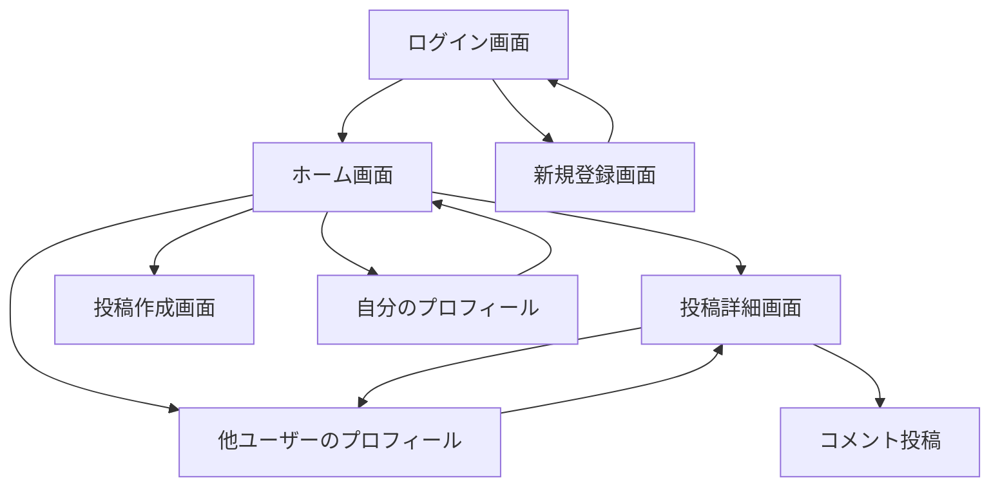

# DESIGN.md

# Echo - 画面・UI設計書

## 1. 概要

### 1.1 目的

本ドキュメントは、匿名SNS「Echo」の画面構成、UIデザイン、レイアウト、画面遷移について定義する。

Claude Codeなどの開発支援ツールは、画面の新規作成や既存画面の修正を行う際、本ドキュメントを参考にすること。

ただし、本ドキュメントと現在のソースコードに差異がある場合は、実際の実装を確認してから変更すること。

### 1.2 デザインコンセプト

Echoは、夜・雨・静けさをイメージした落ち着いた雰囲気のSNSである。

ユーザーが悩みや感情を気軽に投稿できるよう、圧迫感の少ないシンプルなデザインを目指す。

基本的なデザイン方針：

- 夜空をイメージした背景
- 半透明のカードによる奥行きのある表現
- 白色を中心とした文字色
- シンプルで分かりやすい操作ボタン
- 投稿内容を中心とした画面構成
- 過度な装飾を避ける
- 落ち着いて長時間閲覧できるUI

### 1.3 デザインの基本方針

1. 投稿内容を最も目立たせる。
2. 画面全体の統一感を維持する。
3. 各画面で共通のヘッダー・フッターを使用する。
4. 投稿カードのサイズと構造を統一する。
5. 画面サイズが変わっても操作性を維持する。
6. CSSの重複や不要な指定を避ける。

---

# 2. 共通レイアウト

## 2.1 全体構成

基本的な画面構成は以下のとおり。

```text
+------------------------------------------+
|                  Header                  |
|              Echo ロゴ                   |
|              ナビゲーション               |
+------------------------------------------+
|                                          |
|                                          |
|                Main                      |
|                                          |
|             各ページの内容                |
|                                          |
|                                          |
+------------------------------------------+
|                 Footer                   |
|                 © Echo                   |
+------------------------------------------+
```

### 共通構成要素

| 要素 | 役割 |
|---|---|
| Header | ロゴ・ナビゲーション |
| Main | 各ページのコンテンツ |
| Footer | コピーライト表示 |

`app/layout.tsx` で共通レイアウトを管理する。

## 2.2 ヘッダー

### 表示内容

- Echoロゴ
- サービスのサブタイトル
- ナビゲーションメニュー
- ログインユーザー情報（必要に応じて）

### デザイン

- 画面上部に配置する。
- ロゴは中央に配置する。
- ロゴには雲をイメージした装飾を使用する。
- ナビゲーションはPCでは右側に配置する。
- 背景はページ全体の背景を活かす。
- 下部に区切り線を設ける。

### ナビゲーション

ログイン状態に応じて表示内容を変更する。

想定するメニュー：

| 状態 | 表示内容 |
|---|---|
| ログイン済み | ホーム・投稿・プロフィール・ログアウト |
| 未ログイン | ホーム・ログイン・新規登録 |

※実際の表示項目は現在のHeader.tsxを優先する。

### スマートフォン

- ロゴを上部中央に配置する。
- ナビゲーションを下部に配置する。
- メニューが画面幅からはみ出さないようにする。
- 必要に応じて余白や文字サイズを調整する。

## 2.3 フッター

### 表示内容

- © 2026 Echo

### デザイン

- 画面下部に配置する。
- 背景は透明にする。
- 小さめの文字サイズにする。
- 投稿一覧などのスクロール領域と独立させる。

## 2.4 背景

### デザイン

- 夜空をイメージした背景画像を使用する。
- 画面全体を覆うように表示する。
- 背景画像の上に半透明の黒いレイヤーを重ねる。
- 背景画像は画面サイズに合わせて拡大縮小する。

### 実装

背景画像は以下を使用する。

```text
public/images/background.jpg
```

CSSの `body::before` で背景を表示する。

背景画像の上に表示する文字やカードの視認性を確保すること。

---

# 3. ホーム画面

## 3.1 概要

ホーム画面はEchoの中心となる画面である。

ユーザーが投稿を閲覧し、気になる投稿を選択できるようにする。

## 3.2 画面構成

```text
+------------------------------------------------------+
|                       Header                         |
+------------------------------------------------------+
|                                                      |
|                 気持ちから投稿を探す                  |
|                                                      |
|   [恋愛] [人間関係] [仕事] [学校] [家族] [日常]       |
|                  [将来] [その他]                      |
|                                                      |
+------------------------------------------------------+
|                                                      |
|   +----------------+  +----------------+  +----------+|
|   |                |  |                |  |          ||
|   |    投稿者名     |  |    投稿者名     |  | 投稿者名 ||
|   |                |  |                |  |          ||
|   |    投稿内容     |  |    投稿内容     |  | 投稿内容 ||
|   |                |  |                |  |          ||
|   |   編集・削除    |  |   編集・削除    |  | 編集削除 ||
|   +----------------+  +----------------+  +----------+|
|                                                      |
|   +----------------+  +----------------+  +----------+|
|   |                |  |                |  |          ||
|   |    投稿者名     |  |    投稿者名     |  | 投稿者名 ||
|   |    投稿内容     |  |    投稿内容     |  | 投稿内容 ||
|   |   編集・削除    |  |   編集・削除    |  | 編集削除 ||
|   +----------------+  +----------------+  +----------+|
|                                                      |
|                投稿一覧スクロール領域                  |
|                                                      |
+------------------------------------------------------+
|                       Footer                         |
+------------------------------------------------------+
```

※図は構造を示すための概略図であり、実際の余白やカードサイズを厳密に示すものではない。

## 3.3 タグ検索エリア

### 目的

ユーザーが関心のあるテーマから投稿を探せるようにする。

### 表示内容

見出し：

「気持ちから投稿を探す」

タグ：

- 恋愛
- 人間関係
- 仕事
- 学校
- 家族
- 日常
- 将来
- その他

### デザイン

- 投稿一覧の上部に配置する。
- タグボタンは横並びを基本とする。
- 画面幅が狭い場合は折り返す。
- ボタンは角丸のピル型にする。
- 選択中のタグは白背景・濃い文字色にする。
- 未選択のタグは半透明の濃い背景に白文字を使用する。
- ホバー時に背景色と位置をわずかに変化させる。

### 動作

- タグを選択すると該当タグの投稿に絞り込む。
- 選択中のタグを再度選択すると全投稿表示に戻す。
- 選択中のタグを視覚的に判別できるようにする。

### レイアウト上の注意

タグ検索エリアは投稿一覧のスクロール領域に含めない。

タグ検索エリアを固定し、投稿一覧だけをスクロールできる構造にする。

## 3.4 投稿一覧

### 基本レイアウト

投稿一覧はCSS Gridで配置する。

| 画面幅 | 列数 |
|---|---:|
| PC（901px以上） | 3列 |
| タブレット（601px〜900px） | 2列 |
| スマートフォン（600px以下） | 1列 |

### 投稿一覧の表示順

- 新しい投稿を上に表示する。
- タグ検索時も新しい順を維持する。

### スクロール

- 投稿一覧の領域のみスクロール可能にする。
- ヘッダー、タグ検索エリア、フッターは投稿一覧のスクロールに影響されない。
- 投稿一覧の高さは画面の残り領域に合わせる。
- スクロール領域の外側にはみ出さないようにする。

### 実装上の注意

`app/page.tsx` では以下の構造を基本とする。

```tsx
<main className="home-main">
  <section className="home-tag-area">
    {/* タグ検索 */}
  </section>

  <div className="post-grid-scroll">
    <section className="post-grid">
      {/* PostCardを並べる */}
    </section>
  </div>
</main>
```

投稿一覧のスクロールには以下を意識する。

- `flex: 1`
- `min-height: 0`
- `overflow-y: auto`

親要素の高さが正しく設定されていることも確認する。

---

# 4. 投稿カード

## 4.1 概要

投稿カードはホーム画面やプロフィール画面などで投稿を表示するための共通コンポーネントである。

実装ファイル：

```text
components/PostCard.tsx
```

CSSクラス：

```text
.post-card
```

投稿カードは独立したReactコンポーネントとして管理し、複数のカードをGridなどで並べる。

## 4.2 基本構造

投稿カード内部は以下の3領域に分ける。

```text
+----------------------------------+
|                                  |
|             Header               |
|             投稿者名              |
|                                  |
+----------------------------------+
|                                  |
|                                  |
|              Body                |
|             投稿内容              |
|                                  |
|                タグ               |
|                                  |
+----------------------------------+
|                                  |
|             Footer               |
|           編集・削除              |
|                                  |
+----------------------------------+
```

### Header

表示内容：

- 投稿者名

動作：

- 投稿者名を選択するとプロフィール画面へ遷移する。
- 投稿者名が長い場合は省略表示する。

### Body

表示内容：

- 投稿本文
- 投稿タグ

動作：

- 投稿本文を選択すると投稿詳細画面へ遷移する。
- 投稿本文は最大3行まで表示する。
- 3行を超える場合は省略表示する。
- 投稿本文はカード内で中央揃えにする。
- 長文でもカードのサイズが変わらないようにする。
- タグは投稿本文の下に表示する。

### Footer

表示内容：

- 編集ボタン
- 削除ボタン

表示条件：

- 投稿者本人にのみ表示する。

動作：

- 編集ボタンで編集状態に切り替える。
- 削除ボタンで投稿を削除する。
- 編集中は保存・キャンセルボタンを表示する。

## 4.3 カードのデザイン

- 半透明の背景を使用する。
- 背景をぼかす効果を使用する。
- 白色を中心とした文字色にする。
- 角丸は控えめにし、四角形を基本とする。
- ホバー時に背景の透明度を変化させる。

### サイズ

現在の基本サイズ：

- 高さ：220px
- 幅：Gridの列幅に合わせる。
- 内側の余白：24px程度

※実際の値は現在のCSSを優先し、変更時は画面全体のバランスを確認する。

## 4.4 カード内部のレイアウトルール

カード内部の要素はFlexboxを使用して配置する。

基本構造：

```text
post-card
  └── post-card__content
        ├── post-card__header
        │     └── post-card__username
        │
        ├── post-card__body
        │     ├── post-card__post-body
        │     │     └── post-card__post-link
        │     │           └── post-card__text
        │     │
        │     └── post-card__tags
        │
        └── post-card__actions
```

### レイアウト上の重要事項

- カード内部のコンテンツ幅はカード幅に合わせる。
- 投稿本文は中央揃えにする。
- 左右のカードでも中央のカードと同じ配置になるようにする。
- 投稿本文の長さによって他の要素の位置が大きく変わらないようにする。
- 絶対配置（`position: absolute`）に依存しない。
- 可能な限りFlexboxの領域分割で配置する。
- 編集フォームもカードの中央に配置する。
- カードの左右位置に依存するマージンやオフセットを使用しない。

## 4.5 編集状態

編集状態では以下を表示する。

- 投稿内容を入力するテキストエリア
- 保存ボタン
- キャンセルボタン

### デザイン

- テキストエリアはカードの内側に収める。
- 左右に均等な余白を設ける。
- テキストエリアの幅はカード幅を超えない。
- 保存・キャンセルボタンはカード下部に配置する。

---

# 5. 投稿作成画面

## 5.1 概要

ログインユーザーが新しい投稿を作成する画面。

実装ファイル：

```text
app/post/page.tsx
```

## 5.2 表示内容

- 画面タイトル
- 投稿内容入力欄
- タグ選択欄
- 投稿ボタン
- キャンセルまたは戻る操作

## 5.3 レイアウト

```text
+------------------------------------------+
|                  Header                  |
+------------------------------------------+
|                                          |
|               投稿する                   |
|                                          |
|      +----------------------------+      |
|      |                            |      |
|      |       投稿内容入力欄         |      |
|      |                            |      |
|      +----------------------------+      |
|                                          |
|                タグ選択                  |
|                                          |
|      [恋愛] [仕事] [日常] [その他]         |
|                                          |
|             [投稿する]                   |
|                                          |
+------------------------------------------+
|                  Footer                  |
+------------------------------------------+
```

※実際の配置や装飾は現在の実装を優先する。

## 5.4 入力ルール

- 投稿内容を入力できる。
- 空文字や空白のみの投稿は登録できない。
- 複数のタグを選択できる。
- タグは未選択でも投稿できる。
- 投稿処理中は二重送信を防ぐ。

---

# 6. 投稿詳細画面

## 6.1 概要

投稿一覧から選択された投稿の詳細を表示する画面。

実装ファイル：

```text
app/post/[id]/page.tsx
```

## 6.2 表示内容

- 戻る操作
- 投稿者名
- 投稿本文
- 投稿日時
- タグ
- 共感ボタン
- 共感数
- コメント一覧
- コメント入力欄

## 6.3 レイアウト

```text
+------------------------------------------+
|                  Header                  |
+------------------------------------------+
|                                          |
|                投稿詳細                  |
|                                          |
|              投稿者名                     |
|                                          |
|          投稿本文の全文表示               |
|                                          |
|              #タグ #タグ                  |
|                                          |
|              [共感する]                  |
|               共感数                     |
|                                          |
|------------------------------------------|
|                                          |
|                コメント                  |
|                                          |
|       +--------------------------+       |
|       | コメント入力欄            |       |
|       +--------------------------+       |
|              [投稿する]                  |
|                                          |
|       投稿者名                            |
|       コメント内容                        |
|                                          |
|       投稿者名                            |
|       コメント内容                        |
|                                          |
+------------------------------------------+
|                  Footer                  |
+------------------------------------------+
```

## 6.4 投稿情報

- 投稿者名を表示する。
- 投稿本文は全文表示する。
- タグを表示する。
- 投稿日時を表示する。
- 投稿者名からプロフィール画面へ移動できる。

## 6.5 共感エリア

- 共感ボタンを表示する。
- 共感数を表示する。
- 共感済みかどうかを視覚的に判別できるようにする。
- 操作後は表示を更新する。

## 6.6 コメントエリア

- コメントを一覧表示する。
- コメント投稿者名を表示する。
- コメント内容を表示する。
- コメント投稿者名からプロフィール画面へ遷移する。
- 自分のコメントにのみ削除操作を表示する。
- 新しいコメントが適切な順番で表示されるようにする。

---

# 7. プロフィール画面

## 7.1 自分のプロフィール画面

実装ファイル：

```text
app/profile/page.tsx
```

### 表示内容

- ユーザー名
- 自己紹介文
- 編集フォーム

### 編集項目

| 項目 | 制限 |
|---|---|
| ユーザー名 | 必須・最大30文字 |
| 自己紹介 | 最大200文字 |

### 動作

- 自分のプロフィールを取得して表示する。
- ユーザー名を編集できる。
- 自己紹介文を編集できる。
- 保存操作でデータベースを更新する。
- ユーザー名が重複している場合はエラーを表示する。

## 7.2 他ユーザーのプロフィール画面

実装ファイル：

```text
app/profile/[userId]/page.tsx
```

### 表示内容

- 対象ユーザー名
- 自己紹介文
- 対象ユーザーの投稿一覧

### 動作

- URLのuserIdをもとにプロフィール情報を取得する。
- 対象ユーザーの投稿を表示する。
- 投稿を選択すると投稿詳細画面へ遷移する。
- 他ユーザーのプロフィールは編集できない。

---

# 8. ログイン・新規登録画面

## 8.1 ログイン画面

実装ルート：

```text
/login
```

### 表示内容

- Echoロゴまたはタイトル
- メールアドレス入力欄
- パスワード入力欄
- ログインボタン
- 新規登録画面へのリンク
- パスワードリセットへのリンク（実装後）

### 動作

- メールアドレスとパスワードでログインする。
- ログイン成功後はホーム画面へ遷移する。
- 認証エラー時は適切なエラーメッセージを表示する。

## 8.2 新規登録画面

実装ルート：

```text
/signup
```

### 表示内容

- メールアドレス入力欄
- パスワード入力欄
- 登録ボタン
- ログイン画面へのリンク

### 動作

- メールアドレスとパスワードでアカウントを作成する。
- 登録成功後は適切な画面へ遷移する。
- 登録エラー時は適切なエラーメッセージを表示する。

※ログイン・新規登録画面の細かなデザインは、現在の実装を確認してから統一する。

---

# 9. UIコンポーネント設計

## 9.1 共通コンポーネント

| コンポーネント | ファイル | 役割 |
|---|---|---|
| Header | components/Header.tsx | 共通ヘッダー |
| PostCard | components/PostCard.tsx | 投稿カード |

今後、共通化する価値があるUIはコンポーネントとして分離する。

ただし、過度なコンポーネント分割は避ける。

## 9.2 CSSの管理方針

主なスタイルは以下で管理する。

```text
app/globals.css
```

### CSSの基本ルール

- クラス名は役割が分かる名前にする。
- コンポーネント単位で関連するCSSをまとめる。
- 同じクラスの重複定義を避ける。
- 使用していないCSSを放置しない。
- レスポンシブ用のCSSは関連するスタイルの近くにまとめる。
- 不必要な `!important` を使用しない。
- レイアウト調整のためだけに不自然な `left` や `transform` を多用しない。
- FlexboxとGridを適切に使い分ける。

### 命名規則

BEMに近い命名を基本とする。

例：

```css
.post-card {}
.post-card__content {}
.post-card__header {}
.post-card__body {}
.post-card__actions {}
```

## 9.3 レイアウト設計の原則

- ページ全体のレイアウトはFlexboxを基本とする。
- 複数カードの配置にはCSS Gridを使用する。
- カード内部の配置にはFlexboxを使用する。
- 固定サイズが必要な要素以外は、画面サイズに応じて柔軟に調整する。
- `min-width: 0` や `min-height: 0` が必要な場面を考慮する。
- 絶対配置は装飾や限定的な用途に留める。

---

# 10. レスポンシブデザイン

## 10.1 対応方針

PC・タブレット・スマートフォンで利用できるようにする。

### 投稿一覧

| 画面幅 | 列数 |
|---|---:|
| 901px以上 | 3列 |
| 601px〜900px | 2列 |
| 600px以下 | 1列 |

### ヘッダー

- PCではロゴ中央、ナビゲーション右側。
- スマートフォンではロゴ上部、ナビゲーション下部。
- メニュー項目が重ならないようにする。

### 投稿カード

- 画面幅に応じてカード幅を変更する。
- カードの高さは基本的に統一する。
- 長文は省略表示する。
- ボタンがカードからはみ出さないようにする。
- 編集フォームはカード内に収める。

---

# 11. 状態・表示に関する共通ルール

各画面では、以下の状態を適切に扱う。

## 11.1 ローディング

- データ取得中であることを表示する。
- 操作中のボタンは必要に応じて無効化する。
- 処理が完了したら通常表示に戻す。

## 11.2 エラー

- データ取得・登録・更新・削除に失敗した場合はエラーを表示する。
- エラーの原因が分かる情報を適切に扱う。
- 秘密情報や内部情報を画面に表示しない。

## 11.3 空データ

- 投稿が存在しない場合は空状態を表示する。
- タグ検索結果が0件の場合は該当投稿がないことを表示する。
- プロフィールが存在しない場合は適切な案内を表示する。
- コメントが存在しない場合も不自然にならない表示にする。

---

# 12. 画面遷移

基本的な画面遷移は以下のとおり。



### 主な遷移

| 操作 | 遷移先 |
|---|---|
| Echoロゴ | ホーム |
| 投稿カード本文 | 投稿詳細 |
| 投稿者名 | 投稿者プロフィール |
| 投稿ボタン | 投稿作成 |
| プロフィール | 自分のプロフィール |
| ログイン成功 | ホーム |
| 新規登録画面のログインリンク | ログイン |

※実際のリンク先・遷移条件は現在の実装を優先する。

---

# 13. 今後のUI改善候補

以下は今後検討する改善項目であり、現時点で実装済みとは限らない。

- 投稿カードのレイアウトのさらなる最適化
- 投稿カードの編集UI改善
- ローディング表示の改善
- エラー表示の統一
- 空状態のデザイン
- スマートフォンでの操作性改善
- 投稿詳細画面の読みやすさ改善
- プロフィール画面のデザイン統一
- アクセシビリティの改善
- 色・余白・文字サイズなどのデザイントークン化

---

# 14. 実装時の注意事項

Claude Codeなどの開発支援ツールは、画面を変更する前に以下を確認すること。

1. 対象画面の現在のソースコードを確認する。
2. 関連するコンポーネントとCSSを確認する。
3. 共通レイアウトへの影響を確認する。
4. PC・タブレット・スマートフォンでの表示を考慮する。
5. 既存機能の動作を維持する。
6. 変更範囲を必要最小限にする。
7. 不明なデザイン仕様を独自に決めない。
8. 実装後は表示と操作の両方を確認する。

特にホーム画面では、投稿一覧のスクロール領域、タグ検索エリア、フッターの位置関係を崩さないこと。

投稿カードでは、カードの左右位置や投稿本文の長さによって内部要素の配置がずれないことを重視する。

---

# 15. 関連ドキュメント

| ファイル | 役割 |
|---|---|
| README.md | プロジェクト概要・環境構築 |
| REQUIREMENTS.md | 機能要件 |
| DESIGN.md | 画面・UI設計 |
| ARCHITECTURE.md | 技術構成・実装方針 |
| DATABASE.md | DB構造・リレーション |
| TASKS.md | 実装状況・残タスク |